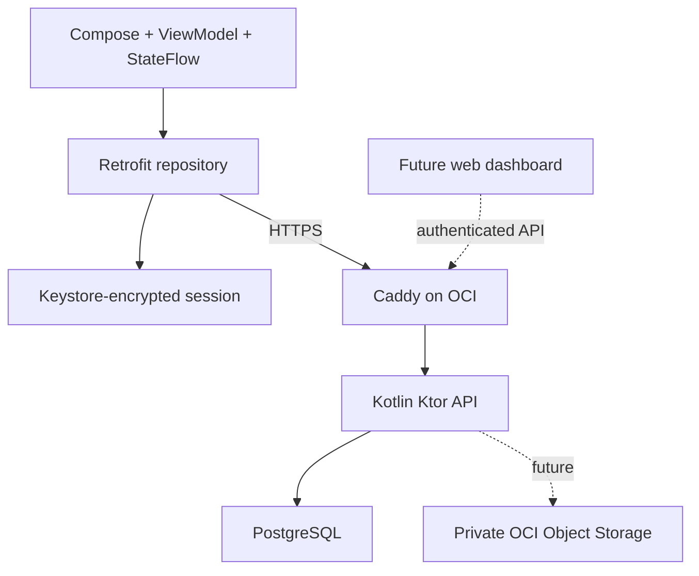

# androidPersonalAppLearning

Personal Device Lab is an Android 13+ learning application for explicitly authorized personal-device management. This is a fresh, independent project; no code or configuration from the parent Android project is reused.

## Status: foundation source, not a verified release

Source and corresponding tests exist for account registration/login, expiring sessions, refresh rotation, device registration, device-scoped metadata synchronization, installation-bound one-time pairing, device revocation and account deletion. The Android app includes endpoint setup, authentication and device management screens with Material 3 light/dark themes. Native session storage uses Android Keystore AES-GCM.

**Kotlin has not been compiled and Kotlin tests have not been executed in the restricted authoring environment. No APK has been generated and no connection to Oracle has been tested.** Only the dependency-free structural checks have run. Do not treat this as production-ready.

The official Gradle wrapper JAR download was blocked by the local Zscaler policy. Launchers, wrapper properties, a pinned distribution checksum and an official checksum-verifying bootstrap script are included. Before a CLI build, run that bootstrap in an authorized environment. The repository is not fully self-contained until the verified wrapper JAR is added. Do not bypass workplace network policy. CI bootstraps the same official artifact on its own runner.

Camera, microphone, location, permission-management UI, WorkManager, Room history, contacts, SMS imports, media transfers, remote requests, Oracle Object Storage and web administration are **not implemented**. They have no placeholder screens pretending to work. See [docs/ROADMAP.md](docs/ROADMAP.md).

## Architecture



- `app`: Kotlin/Compose UI, ViewModel, repository, device metadata and security.
- `shared`: serialized API contracts and validation shared by Android/backend.
- `backend`: Ktor, bounded JSON HTTP APIs, JDBC transactions and SQL schema.
- `deploy`: container deployment configuration for an existing OCI VM.
- `docs`: API, architecture, deployment and testing guides.
- `.github/workflows`: separate Android and backend checks; real PostgreSQL in backend CI.

Pinned compatible baseline: AGP 8.9.2, Gradle 8.11.1, Kotlin 2.1.20, JDK 17, compile/target SDK 35, minimum SDK 33. These are deliberately pinned, not a claim to be the newest versions. Dependencies live in [gradle/libs.versions.toml](gradle/libs.versions.toml). Review current target-SDK distribution requirements and dependency security updates before publishing.

## Android Studio Setup

1. Publish **this directory**, not the parent workspace, to a separate private GitHub repository named `androidPersonalAppLearning`. Keep secrets out of Git.
2. Clone `https://github.com/YOUR_ACCOUNT/androidPersonalAppLearning.git` through Android Studio's Version Control dialog. Substitute your actual account.
3. Use an Android Studio version supporting AGP 8.9, configure JDK 17 for Gradle, and install SDK Platform 35 through that authorized development environment.
4. On an authorized Windows machine, run `powershell -File scripts/bootstrap-wrapper.ps1`. It downloads only the official wrapper JAR and verifies both wrapper and pinned-distribution checksums. On Linux/macOS, PowerShell 7 runs the same script; alternatively generate the official 8.11.1 wrapper using an already authorized Gradle installation and verify it against Gradle's published checksum.
5. Commit the verified wrapper JAR to make subsequent clones self-contained. Do not commit SDKs, Gradle distributions, build directories, tokens, private keys or local configuration.
6. Open this project's root and allow Android Studio to synchronize Gradle. It resolves declared dependencies; nothing was installed on the restricted authoring computer.

No OCI credential is required to build the APK. The app asks for the public HTTPS API origin when launched. It never accepts a cloud private key.

## Build and Install

From this directory, in the authorized Android Studio environment:

```powershell
.\gradlew.bat :shared:test :backend:test :app:testDebugUnitTest :app:lintDebug
.\gradlew.bat :app:assembleDebug
```

APK: `app/build/outputs/apk/debug/app-debug.apk`. Install via Android Studio Run or, when Android platform tools are available:

```powershell
adb install -r app/build/outputs/apk/debug/app-debug.apk
```

Linux/macOS: use `bash gradlew` in place of `.\gradlew.bat`. A release APK requires your own signing configuration and secure key management; no signing key is supplied. Do not distribute debug builds as production releases.

The JVM backend can build without Android SDK configuration:

```powershell
.\gradlew.bat -PbackendOnly :shared:test :backend:test :backend:installDist
```

## First End-to-End Test

1. Deploy the backend following [docs/DEPLOYMENT.md](docs/DEPLOYMENT.md), with valid HTTPS and a strong server-only registration invitation.
2. Launch the Android app and enter your HTTPS origin, for example `https://devices.example.com`. No paths, embedded credentials or query parameters are accepted.
3. Create an account with an email, a 12-128 character password and the invitation supplied privately by the server administrator. Email verification/password recovery are not implemented.
4. Enter a device name and explicitly approve registration. Synchronize status and inspect the server's device list.
5. Sign into the same account on the other phone. Its dashboard shows its installation UUID before enrollment.
6. On the first phone, enter the second installation UUID and create a pairing code. Transfer this short-lived secret privately. On the second phone, enter the code and approve registration. The code is valid once for five minutes and only for that account/installation. QR scanning is not implemented.
7. Revoke a device and confirm it can no longer synchronize or refresh its bound session. Existing registered installation IDs cannot re-enroll after revocation. A fresh install creates a new UUID; an authenticated account can intentionally register new installations. This is not hardware attestation or an enterprise enrollment lock.

Registration without a pairing code is allowed for authenticated owners on their own installations. Pairing is an additional authorized onboarding flow, not a mandatory account security factor.

Metadata synchronization is manual in this milestone. "Recently seen" means a heartbeat within five minutes at the time the screen renders, not a live connectivity guarantee. Remote permission status is not collected yet.

## Oracle Cloud

The supplied screenshots show an Ubuntu 20.04 `VM.Standard.E2.1.Micro` VM in Hyderabad, 1 GB RAM, a 47 GB boot volume and no extra block volumes. They do not prove free-tier billing eligibility, free disk space, routing, firewall ingress, TLS readiness or SSH reachability.

Use this VM only as a constrained two-device learning deployment after security/support and capacity checks. Ubuntu 20.04 standard support has ended; use approved extended security coverage or provision a supported LTS replacement. Do not perform an unattended in-place upgrade or destroy existing workloads.

The deployment uses a single bounded JVM process, PostgreSQL and Caddy. Builds happen in CI/Android Studio, not on the micro VM. The DB and API ports are not published. Private Object Storage and instance-principal IAM will be added in the media phase; there is no reason to collect OCI keys now.

Read [docs/ARCHITECTURE.md](docs/ARCHITECTURE.md) for costs, tradeoffs and security boundaries. Free-tier limits and region capacity must be confirmed in your own console before provisioning; zero cost and uptime cannot be guaranteed.

## Permissions and Privacy

This foundation declares only `INTERNET` and `ACCESS_NETWORK_STATE`, both normal permissions. It accesses no location, camera, microphone, contacts, SMS, Bluetooth or user files. Passwords and pairing invitations are not saved. Tokens are encrypted under a non-exportable Keystore key; backups/transfers are excluded and screen capture is disabled for this app window.

Device names, installation UUIDs, model/OS information, battery and connectivity metadata are sent only to the configured server after enrollment/synchronization. Account deletion removes active database records via cascading foreign keys; backup expiry is an operator responsibility. Server logs must never include authorization headers, secrets or request bodies.

See [SECURITY.md](SECURITY.md) for threat boundaries and reporting. No administrator privilege bypass, hidden monitoring, other-app data access or silent sensor activation is planned.

## Testing

Run the local, dependency-free structure check:

```powershell
.\scripts\verify-structure.ps1
```

It checks XML syntax, manifest privacy settings, catalog references, script syntax and test-suite presence. It **does not** validate Kotlin behavior. See [docs/TESTING.md](docs/TESTING.md) for unit, repository, HTTP, real PostgreSQL and device tests and [docs/API.md](docs/API.md) for endpoint contracts.

CI installs/resolves its tools on external GitHub-hosted runners, not this computer. CI has been authored but has not run yet. Enable GitHub secret scanning/push protection where available; CI is not a security certification.

## Troubleshooting

| Symptom | Check |
| --- | --- |
| Missing wrapper JAR | Bootstrap in an authorized environment, verify checksum, then commit the official JAR. |
| Gradle sync fails | JDK 17, SDK 35, compatible Android Studio, proxy policy and repository access. Do not disable TLS validation. |
| HTTPS connection fails | DNS, certificate hostname/trust, public port 443, OCI route/NSG/security list and host firewall. HTTP/self-signed certificates are intentionally rejected. |
| HTTP 401 | Expired/revoked session; sign in again. A revoked installation cannot silently restore enrollment. |
| HTTP 403 at registration | Incorrect server invitation; never paste it into a public issue. |
| HTTP 429 | Conservative per-minute rate limit or session/pairing cap. Behind Caddy, requests share a proxy-origin limit. Wait or deliberately review the server limits. |
| Pairing rejected | Check account, exact target UUID, five-minute expiry and whether the code was already consumed. |
| Container exits/OOM | Inspect memory/disk/CPU usage without dumping secrets. The 1 GB VM has no measured capacity guarantee. |
| Device absent after reinstall | UUIDs/Keystore keys are installation-specific, not hardware identifiers. Re-register intentionally. |

No GitHub repository, Oracle resource or remote configuration is created automatically. Required external inputs are the GitHub destination and a DNS name pointing to your server, plus confirmation of supported server security coverage. Keep passwords, SSH keys and OCI tokens out of chat and source control.